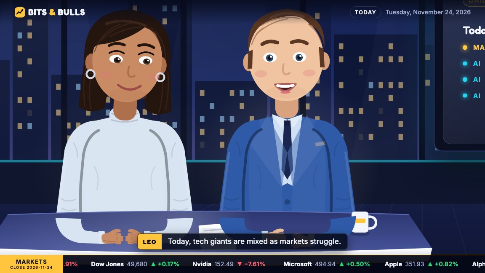
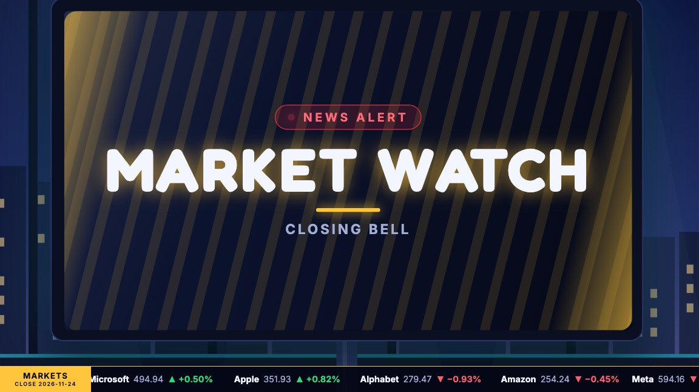
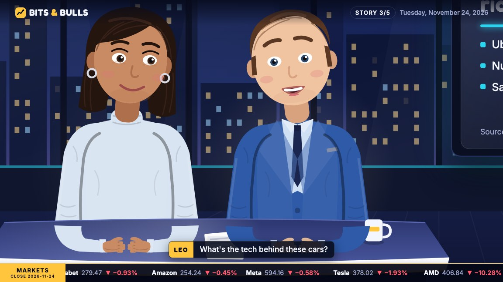
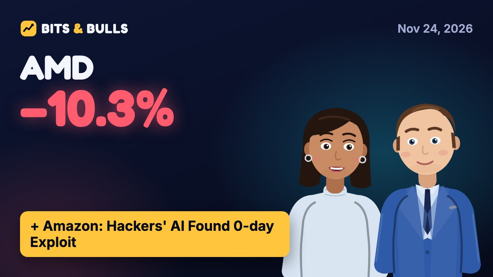
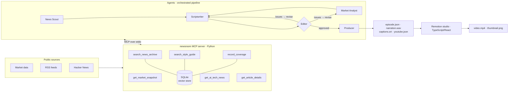
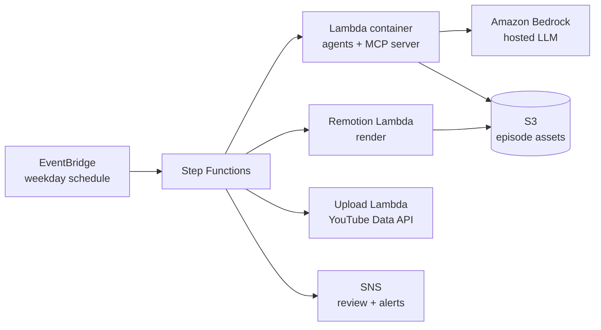

<div align="center">

# 📈 newsroom-ai

### A multi-agent AI newsroom that produces a daily animated markets & AI-news show

**Live market data → AI/tech news → fact-checked two-anchor script → voices → broadcast-style video.**<br/>
One command, under three minutes of video, ready for YouTube.




</div>

---

## Table of contents

- [What it does](#what-it-does)
- [Screenshots](#screenshots)
- [Architecture](#architecture)
  - [The agents](#the-agents)
  - [MCP server](#mcp-server)
  - [Retrieval-augmented generation](#retrieval-augmented-generation)
  - [Fact-checking and safety rails](#fact-checking-and-safety-rails)
  - [Video studio](#video-studio)
- [Quick start](#quick-start)
- [Configuration](#configuration)
- [Outputs](#outputs)
- [Project structure](#project-structure)
- [Development](#development)
- [Responsible publishing](#responsible-publishing)
- [Roadmap](#roadmap)
- [Troubleshooting](#troubleshooting)
- [License and credits](#license-and-credits)

---

## What it does

Every day, `newsroom-ai` produces an episode of **Bits & Bulls**, a short news show hosted by two
original animated co-anchors, **Maya** and **Leo**:

1. **Gathers** the closing numbers for the S&P 500, Nasdaq, Dow and an AI/big-tech watchlist, plus
   the last 30 hours of AI and technology news from RSS feeds and Hacker News.
2. **Edits** like a newsroom: five cooperating agents pick the stories, write a natural two-person
   dialogue, fact-check every number and name against the sources, and enforce a strict time budget.
3. **Produces** the show: per-anchor voices, per-sentence captions, lip-sync tracks, an original
   synthesized "news alert" sting before each segment, chapters and sources for the YouTube
   description, and a thumbnail.
4. **Renders** a 1080p broadcast-style video: a virtual camera cuts between wide, two-shot,
   close-up and big-screen shots of an illustrated newsroom, with a live ticker and lower thirds.

The default stack is **free and runs locally**: Ollama for the LLM, Kokoro for the voices, public
data sources. Every provider is pluggable, so moving to hosted models or premium voices is a
config change, not a rewrite.

### Highlights

| | |
|---|---|
| 🤖 **Multi-agent pipeline** | News Scout, Market Analyst, Scriptwriter, Editor and Producer, each with one job |
| 🔌 **MCP-native** | All data and memory access goes through a Model Context Protocol server over stdio |
| 🧠 **RAG memory** | Semantic archive of past shows (no repeats, automatic follow-ups) plus a retrievable style guide |
| ✅ **Grounded output** | Deterministic checks reject numbers that don't match the data and names that aren't in the source |
| 🎙️ **Two-anchor dialogue** | Distinct voices, hand-offs and reactions, speaker-tagged captions |
| 🎬 **Broadcast look** | Newsroom set, big TV on a stand, camera cuts, news-alert bumpers, ticker, lower thirds |
| 🎭 **Expressive anchors** | Script-driven expressions, emphasis gestures, glances at notes, natural posture shifts |
| 👔 **Daily wardrobe** | Each anchor gets a different seeded outfit every episode |
| ⏱️ **Hard 3-minute cap** | The Producer measures real audio and drops the lowest-ranked story if needed |
| 💸 **$0 to run** | Local LLM and TTS; deterministic fallbacks keep the run going if the model fails |

---

## Screenshots

| Anchor beside the big screen | News alert bumper |
|---|---|
|  |  |
| **Close-up while a co-anchor reacts** | **Auto-generated YouTube thumbnail** |
|  |  |

---

## Architecture



The system has two halves joined by a single data contract, `episode.json`:

- **`newsroom/` (Python)**: the MCP server, the agents, RAG, text-to-speech and audio.
- **`studio/` (TypeScript)**: a Remotion project that renders the episode as video.

### The agents

The orchestrator (`pipeline.py`) runs the agents as a deterministic workflow. Agents exchange
typed Pydantic objects (`NewsItem`, `MarketBrief`, `ShowScript`, `Episode`), and the Editor's
feedback is routed back to whichever agent wrote the failing copy.

| Agent | Uses LLM | Responsibility |
|---|:---:|---|
| **News Scout** | ✅ | Pulls ~25 candidates, drops stories already covered (RAG), flags follow-ups, asks the LLM to pick the five most newsworthy, enriches each with the publisher's own description |
| **Market Analyst** | ✅ | Builds a verified fact sheet from market data and writes the markets dialogue from it |
| **Scriptwriter** | ✅ | Writes each story as a dialogue (lead reports, co-anchor reacts), plus the open and sign-off, guided by the retrieved style guide |
| **Editor** | — | Rule-based standards desk: number checks, grounding checks, attribution, advice/hype filters, on-screen text limits; up to two revision rounds, then source-only fallback |
| **Producer** | — | Voices each line, inserts alert stings, builds captions and lip-sync tracks, enforces the time cap, writes YouTube chapters, sources and disclosures |

Every LLM call has a deterministic fallback, so a slow or confused model degrades the copy but never
breaks the daily run.

### MCP server

`newsroom/src/newsroom/mcp_server.py` is a standard MCP server (Python SDK v2, `MCPServer`) that
agents reach over **stdio**. Because it speaks the standard protocol, the same tools also work from
Claude Desktop or any other MCP client.

| Tool | Purpose |
|---|---|
| `get_market_snapshot` | Index and watchlist closes with one-month history |
| `get_ai_tech_news` | De-duplicated, ranked AI/tech stories from the last N hours |
| `get_article_details` | Publisher name and official description from page metadata (grounding) |
| `search_news_archive` | RAG lookup over stories covered on previous shows |
| `search_style_guide` | RAG lookup over the newsroom style guide |
| `record_coverage` | Writes today's stories into the archive |

### Retrieval-augmented generation

A small SQLite-backed vector store (`rag/store.py`) holds two collections:

- **Archive (memory across days):** after each show, covered stories are embedded and saved. The
  next day, each candidate is searched against the previous week: similarity ≥ 0.80 is a repeat
  and is skipped; 0.55–0.80 becomes a **follow-up**, which gets its own alert and on-air framing.
- **Style guide:** `rag/style_guide.md` is chunked by section, and the most relevant rules (tone,
  number formatting, attribution, length) are retrieved into each writing prompt.

Embeddings default to an offline feature-hashing model for zero setup. Set `EMBEDDER=ollama` to use
`nomic-embed-text` for true semantic matching.

### Fact-checking and safety rails

Small local models write well but drift on facts, so correctness is enforced **in code**, not by
the model:

- **Numbers:** every percentage, index level and price in the market copy must match the fact
  sheet within rounding tolerance.
- **Grounding:** proper nouns and numbers in a story that don't appear in the source title or
  description are flagged as possible hallucinations and sent back for rewrite.
- **Attribution:** every story must name its outlet on air.
- **Compliance:** investment-advice phrasing ("you should buy", "price target") and hype words are
  rejected; a not-financial-advice disclaimer is always appended by code, never by the model.
- **Fallback:** copy that still fails after two revisions is replaced with text built directly from
  the source.

### Video studio

`studio/` is a [Remotion](https://www.remotion.dev) project. Everything is drawn in code (SVG and
React), so there are no stock assets and nothing to license.

- **Newsroom set:** night-city window, monitor wall, studio lights, glossy floor, anchor desk, and
  a big TV on a stand that plays the graphics.
- **Virtual camera:** shots are planned from caption timing: wide establishing shot, desk
  two-shot, speaker close-ups, "anchor beside the screen", and full-screen graphics for alerts and
  charts, each with a slow drift.
- **Anchors:** original illustrated characters with loudness-driven lip-sync from per-anchor
  envelopes precomputed in Python, so renders are deterministic. Delivery is read from the script:
  questions raise the brows and tilt the head, exclamations widen the smile, and emphasis words
  (numbers, "record", "launch", "surge"…) trigger a hand gesture and a stronger nod. Listeners smile,
  turn toward the speaker and glance down at their notes; both anchors blink, breathe and shift in
  their chairs.
- **Graphics:** animated index cards, a one-month chart, top movers, story cards, news-alert
  bumpers, a scrolling ticker and speaker-tagged lower thirds.
- **Thumbnail:** a separate 1280×720 composition highlighting the day's biggest mover.

---

## Quick start

**Requirements:** Python 3.12, [uv](https://docs.astral.sh/uv/), Node.js 20+,
[Ollama](https://ollama.com), and about 10 GB of disk space for the models.

```bash
git clone https://github.com/Hamidreza59/newsroom-ai.git
cd newsroom-ai

make setup      # Python + Node deps, Kokoro voice models, pulls qwen2.5:14b
make demo       # offline: sample data, no LLM, silent audio — renders a video in ~5 min
make episode    # today's real show: live data, Ollama, Kokoro, rendered video
```

Open the result:

```bash
open out/$(date +%F)/video.mp4
```

Preview and tweak the animation live in the browser with `make studio`.

<details>
<summary><b>Run the steps individually</b></summary>

```bash
cd newsroom
uv run newsroom run --help              # all options
uv run newsroom run --offline --llm mock --tts silent
uv run newsroom run --llm ollama --tts kokoro
uv run newsroom render --date 2026-11-24
uv run newsroom tools                   # list the MCP server's tools
```

</details>

---

## Configuration

Copy `.env.example` to `.env`. All settings are optional.

| Variable | Default | Notes |
|---|---|---|
| `LLM_PROVIDER` | `ollama` | `ollama`, `openai` (any OpenAI-compatible API, such as Groq, OpenRouter or OpenAI) or `mock` |
| `OLLAMA_MODEL` | `qwen2.5:14b` | Any local model with JSON output |
| `OPENAI_BASE_URL` / `OPENAI_API_KEY` / `OPENAI_MODEL` | Groq endpoint | Used when `LLM_PROVIDER=openai` |
| `TTS_PROVIDER` | `kokoro` | `kokoro` (Apache-2.0 voices), `say` (macOS preview only) or `silent` |
| `ANCHOR_A_NAME` / `ANCHOR_A_VOICE` | `Maya` / `af_heart` | Any Kokoro voice |
| `ANCHOR_B_NAME` / `ANCHOR_B_VOICE` | `Leo` / `am_michael` | Any Kokoro voice |
| `EMBEDDER` | `hashing` | `ollama` for `nomic-embed-text` |
| `STORIES_PER_SHOW` | `5` | Upper bound; the Producer may drop stories to fit |
| `MAX_SECONDS` | `178` | Hard cap on episode length |
| `SHOW_NAME` | `Bits & Bulls` | Used on screen, in the script and in metadata |

---

## Outputs

Each run writes to `out/<YYYY-MM-DD>/`:

| File | Description |
|---|---|
| `video.mp4` | 1920×1080 H.264 at 30 fps, under 3 minutes |
| `thumbnail.png` | 1280×720 YouTube thumbnail |
| `youtube.json` | Title, description with chapters, sources and disclosures, and tags |
| `captions.srt` | Speaker-labelled subtitles for YouTube |
| `script.md` | Readable two-anchor script with source links, for human review |
| `episode.json` | The renderer's input: scenes, captions, market data, lip-sync tracks |
| `narration.wav` | Mixed voices and alert stings |

---

## Project structure

```
newsroom-ai/
├── newsroom/                      Python package (uv)
│   ├── src/newsroom/
│   │   ├── mcp_server.py          MCP tools: market, news, article details, RAG
│   │   ├── pipeline.py            orchestrator: agents, revision loop, time budget
│   │   ├── agents/                news_scout · market_analyst · scriptwriter · editor · producer
│   │   ├── data/                  market data, RSS + Hacker News, sample data
│   │   ├── rag/                   embedders, SQLite vector store, style_guide.md
│   │   ├── llm.py                 Ollama / OpenAI-compatible / mock providers
│   │   ├── tts.py                 Kokoro / macOS say / silent engines
│   │   ├── sfx.py                 synthesized news-alert sting
│   │   └── cli.py                 `newsroom` command
│   └── tests/
├── studio/                        Remotion project (TypeScript/React)
│   ├── src/DailyShow.tsx          main composition
│   ├── src/Thumbnail.tsx
│   ├── src/scenes/                intro · market · news · outro (big-TV content)
│   └── src/components/            Newsroom set + camera, Presenter, wardrobe, AlertCard, charts, ticker
├── docs/images/                   README screenshots
├── Makefile
└── .env.example
```

---

## Development

```bash
make test
```

This runs `pytest` (including an end-to-end offline episode and the MCP server over its real
protocol), `ruff`, and `tsc --noEmit` for the studio.

The offline path (`--offline --llm mock --tts silent`) needs no network or model, which keeps the
tests fast and deterministic.

---

## Responsible publishing

This project is built to make trustworthy content. Before monetizing a channel:

- **Market data licensing:** the default market-data endpoint is unofficial and not licensed for
  commercial redistribution. Swap `data/market.py` for a licensed provider.
- **News usage:** only headlines and publisher-supplied descriptions are used, always attributed
  on air and linked in the description. Review `script.md` before each upload.
- **AI disclosure:** the description states that the hosts are AI-generated characters and that
  the show is produced with AI tools. Also use YouTube's altered or synthetic content setting where
  it applies.
- **Original value:** platforms limit monetization of mass-produced content. Human review,
  commentary and editorial choices make a channel more valuable and more durable.
- **Not financial advice:** the disclaimer is spoken and shown on every episode and cannot be
  removed by the model.

---

## Roadmap

**v1:** local daily production with free components, expressive two-anchor newsroom.

**Next: cloud automation on AWS**



- [ ] Containerized pipeline on AWS Lambda, triggered by EventBridge after the market close
- [ ] Hosted LLM provider (Amazon Bedrock) and semantic embeddings
- [ ] Distributed rendering with Remotion Lambda, assets in S3
- [ ] Optional human-approval step, then upload through the YouTube Data API
- [ ] Licensed market-data provider
- [ ] Premium voice provider (ElevenLabs/OpenAI TTS) behind the existing `TtsEngine` interface
- [ ] Optional photoreal presenters through an AI-avatar provider
- [ ] Music bed and per-episode intro sequence

---

## Troubleshooting

| Symptom | Fix |
|---|---|
| `npm install` fails with `UNABLE_TO_GET_ISSUER_CERT_LOCALLY` behind a TLS-inspecting proxy | Export your system roots (`security find-certificate -a -p /Library/Keychains/System.keychain /System/Library/Keychains/SystemRootCertificates.keychain > ~/ca.pem`) and set `NODE_EXTRA_CA_CERTS=~/ca.pem` |
| `uv sync` SSL errors behind a proxy | `uv sync --native-tls` |
| LLM warnings and template-sounding copy | Make sure `ollama serve` is running and the model is pulled (`ollama pull qwen2.5:14b`) |
| Episode drops a story | Expected when the narration would exceed `MAX_SECONDS`; the lowest-ranked story is removed |
| Mouth not moving in Remotion Studio | The sample episode has no audio; run `make episode` and open that episode |

---

## License and credits

Released under the [MIT License](LICENSE). The *Bits & Bulls* name, the Maya and Leo characters,
the set design and the sound effects are original to this project.

Built with
[Model Context Protocol](https://modelcontextprotocol.io) ·
[Remotion](https://www.remotion.dev) ·
[Ollama](https://ollama.com) ·
[Kokoro-82M](https://huggingface.co/hexgrad/Kokoro-82M) via [kokoro-onnx](https://github.com/thewh1teagle/kokoro-onnx) ·
[Pydantic](https://docs.pydantic.dev) ·
[uv](https://docs.astral.sh/uv/).

Remotion is free for individuals and small teams; check the
[Remotion license](https://www.remotion.dev/license) if you use it in a larger company.
