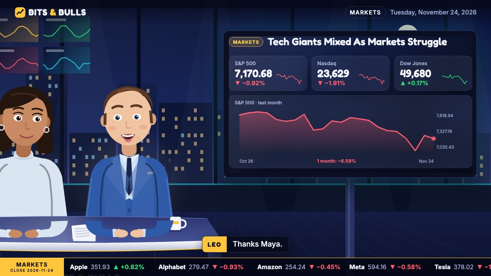
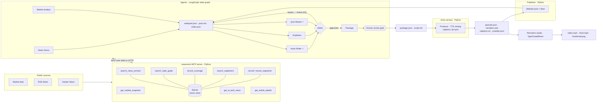
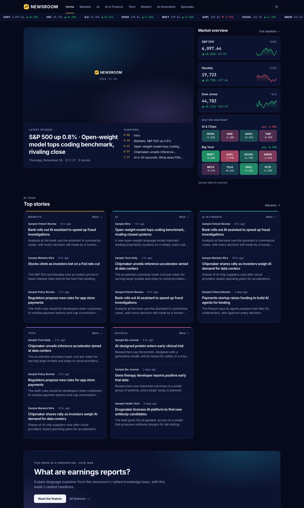
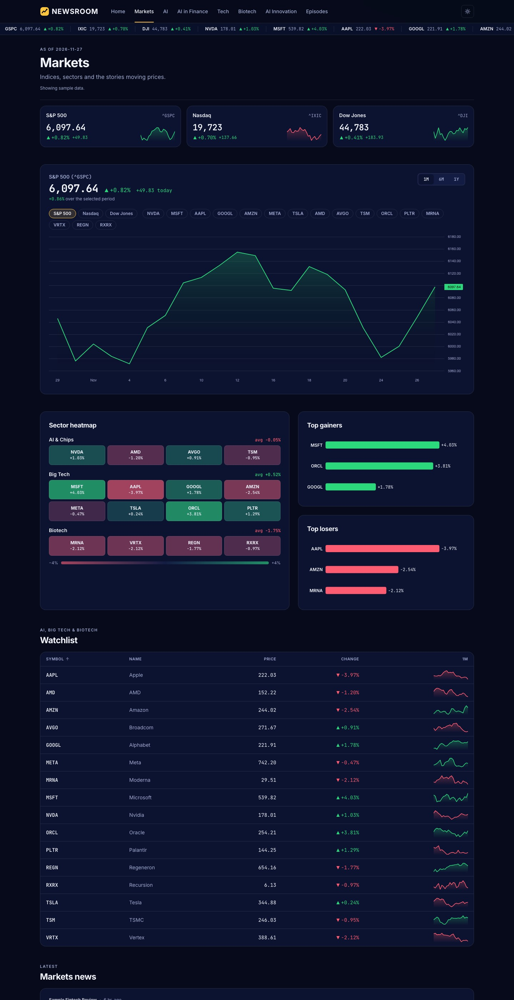
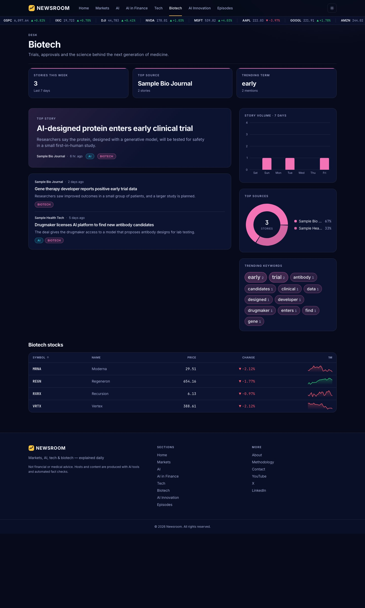
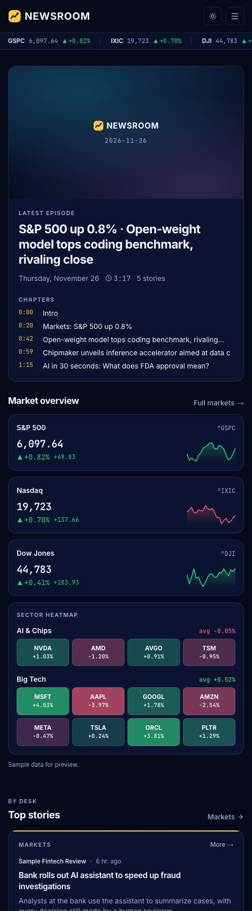
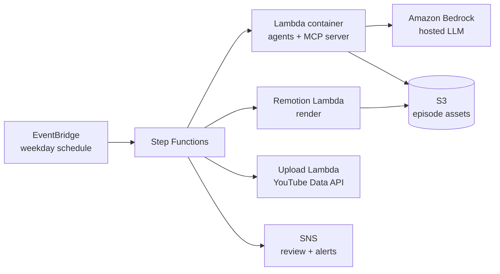

<div align="center">

# 📈 newsroom-ai

### A multi-agent AI newsroom that produces a daily animated markets, AI, tech & biotech news show

**Live market data → AI/tech news → fact-checked two-anchor script → voices → broadcast-style video.**<br/>
One command, under four minutes of video, ready for YouTube.<br/>
Built as independently deployable microservices in one monorepo.


</div>

---

## Table of contents

- [What it does](#what-it-does)
- [Screenshots](#screenshots)
- [Architecture](#architecture)
  - [Services](#services)
  - [Contracts and no-drift types](#contracts-and-no-drift-types)
  - [The agents](#the-agents)
  - [MCP server](#mcp-server)
  - [Retrieval-augmented generation](#retrieval-augmented-generation)
  - [Model routing](#model-routing)
  - [Guardrails](#guardrails)
  - [Fact-checking and safety rails](#fact-checking-and-safety-rails)
  - [Video studio](#video-studio)
  - [Website](#website)
- [Quick start](#quick-start)
- [Configuration](#configuration)
- [Outputs](#outputs)
- [Project structure](#project-structure)
- [Development](#development)
- [Responsible publishing](#responsible-publishing)
- [Roadmap](#roadmap)
- [Troubleshooting](#troubleshooting)
- [License and credits](#license-and-credits)

---

## What it does

Every day, `newsroom-ai` produces an episode of **Bits & Bulls**, a short news show hosted by two
original animated co-anchors, **Maya** and **Leo**:

1. **Gathers** the closing numbers for the S&P 500, Nasdaq, Dow and an AI, big-tech and biotech
   watchlist, plus the last 30 hours of AI, technology and biotech news from RSS feeds (including
   STAT, Nature Biotechnology, BioPharma Dive and GEN) and Hacker News.
2. **Edits** like a newsroom: eight cooperating agents, orchestrated with **LangGraph**, pick the
   stories, write a natural two-person dialogue, add a cold-open hook, an "AI in 30 seconds"
   explainer and a daily quiz, fact-check every number and name, and enforce a strict time budget.
3. **Produces** the show: per-anchor voices, per-sentence captions, lip-sync tracks, an original
   synthesized "news alert" sting before each segment, chapters and sources for the YouTube
   description, and a thumbnail.
4. **Renders** a 1080p broadcast-style video, where a virtual camera cuts between wide, two-shot,
   close-up and big-screen shots of an illustrated newsroom, plus a vertical **YouTube Short** of
   the top story.

The default stack is **free and runs locally**: Ollama for the LLM, Kokoro for the voices, public
data sources. Every provider is pluggable, so moving to hosted models or premium voices is a
config change, not a rewrite.

### Highlights

| | |
|---|---|
| 🤖 **Multi-agent LangGraph** | Eight single-purpose agents in a state graph with parallel branches, a bounded revision loop and a human-approval gate |
| ⚡ **Right-sized models** | Each agent declares a `fast` or `smart` tier; cheap models do constrained jobs that code can verify |
| 🛡️ **Guardrails** | Prompt-injection hygiene, content policy, least-privilege tools, LLM budget + circuit breaker, PII redaction, audit log |
| 🔌 **MCP-native** | All data and memory access goes through a Model Context Protocol server over stdio or streamable HTTP |
| 🧠 **RAG memory** | Semantic archive of past shows (no repeats, automatic follow-ups) plus a retrievable style guide |
| ✅ **Grounded output** | Deterministic checks reject numbers that don't match the data and names that aren't in the source |
| 🎙️ **Two-anchor dialogue** | Distinct voices, hand-offs and reactions, speaker-tagged captions |
| 🎬 **Broadcast look** | Newsroom set, big TV on a stand, camera cuts, news-alert bumpers, ticker, lower thirds |
| 🎭 **Expressive anchors** | Script-driven expressions, emphasis gestures, glances at notes, natural posture shifts |
| 🧬 **Biotech desk** | Biotech feeds and category, biotech stocks, a balanced rundown, and a medical-claims guardrail |
| 🎯 **Engagement segments** | Cold-open hook, "AI in 30 seconds" explainer from a vetted knowledge base, daily quiz with tomorrow's reveal |
| 📱 **Auto Shorts** | A vertical 1080×1920 cut of the hook and top story, ≤ 58 s |
| 👔 **Daily wardrobe** | Each anchor gets a different seeded outfit every episode |
| ⏱️ **Hard 4-minute cap** | The agents estimate runtime and the voice service measures real audio, dropping the lowest-ranked story if needed |
| 💸 **$0 to run** | Local LLM and TTS; deterministic fallbacks keep the run going if the model fails |

---

## Screenshots

| Anchor beside the big screen | News alert bumper |
|---|---|
|  |  |
| **Close-up while a co-anchor reacts** | **Auto-generated YouTube thumbnail** |
|  |  |

---

## Architecture



The system is a monorepo of small services that only talk through files and MCP, so each one can
run on its own today and map onto S3 and Step Functions later. The services meet at two data
contracts: `package.json` (agents → voice) and `episode.json` (voice → studio and publisher).

### Services

| Service | Responsibility | Input → output | Run | Deploy target (later) |
|---|---|---|---|---|
| `newsroom-mcp` | Market data, news wire, RAG memory as MCP tools | MCP calls → tool results | `newsroom-mcp --transport http --port 8765` | ECS Fargate or App Runner service |
| `agents` | LangGraph newsroom: pick, write, fact-check, estimate runtime, review gate | MCP tools → `package.json`, `script.md`, run reports | `newsroom-agents run` | Step Functions task (Lambda container or Fargate) |
| `voice` | TTS, timing, captions, lip-sync, deterministic time cap | `package.json` → `episode.json`, `narration.wav`, `captions.srt`, `youtube.json`, `short.json` | `newsroom-voice build` | Fargate task (needs the Kokoro models) |
| `studio` | Remotion render of the episode | `episode.json` + audio → `video.mp4`, `short.mp4`, `thumbnail.png` | `npm run render -- <dir>` | Remotion Lambda or a Fargate task |
| `publisher` | Website post and feed for the company site | `episode.json`, `youtube.json` → `web/post.json`, `web/post.md`, `out/web/index.json` | `newsroom-publisher build` | Lambda writing to S3 |
| `api` | Website backend: markets, tagged news tabs, episodes and weekly features as JSON, plus episode media | MCP tools + `out/` → `/api/*` JSON, `/media/*` ([contract](services/api/README.md)) | `newsroom-api` | Lambda + API Gateway, or App Runner |
| `web` | Next.js website: home, markets with interactive charts, desks, AI Innovation features and episodes | `api` JSON + `/media/*` → pages | `make web` | S3 + CloudFront (static export) or Amplify / App Runner |

Shared code lives in `packages/newsroom-core` (Pydantic models, settings, HTTP helpers), and each
service ships its own Dockerfile (build context is the repo root).

### Contracts and no-drift types

The website API's responses are defined the same way in `newsroom_core/site.py` and committed as
`packages/contracts/site.schema.json`.

`episode.json` is defined once, by the `Episode` Pydantic model in `newsroom-core`. The JSON Schema
generated from it is committed as `packages/contracts/episode.schema.json`, and the studio's
TypeScript types (`services/studio/src/contract.ts`) are generated from that schema, so the
Python producer and the TypeScript renderer cannot drift apart. A pytest regenerates the schema in
memory and fails if the committed file is stale; `tsc --noEmit` fails if the studio stops matching
the types. After changing a model, run `make contracts`.

### The agents

The orchestrator (`services/agents/.../pipeline.py`) is a **LangGraph `StateGraph`**. Market and Scout run in
parallel, the three segment agents run in parallel after the Scriptwriter, the Editor's feedback
loops back through a conditional edge (at most two rounds), and an optional `interrupt` asks a
human to approve episodes where guardrails had to rewrite on-air copy. Agents exchange typed
Pydantic objects through the graph state. Run `uv run newsroom-agents graph` to print the live graph.

| Agent | Tier | Responsibility |
|---|:---:|---|
| **News Scout** | 🧠 smart | Screens ~25 candidates (content policy, injection hygiene), drops repeats via RAG, flags follow-ups, picks the top stories, enriches them with publisher descriptions |
| **Market Analyst** | 🧠 smart | Writes the markets dialogue from a verified fact sheet |
| **Scriptwriter** | 🧠 smart | Writes each story as a two-anchor dialogue, plus the open and sign-off, guided by the retrieved style guide |
| **Hook Writer** | ⚡ fast | Writes the 5-second cold open from the top story and the biggest market move |
| **Explainer** | 🧠 smart | Picks a concept tied to today's news from a curated knowledge base and explains it in about 30 seconds |
| **Quiz Master** | ⚡ fast | Writes a multiple-choice question about today's news; reveals the last show's answer from memory |
| **Feature Writer** | 🧠 smart | Weekly (`newsroom-agents weekly`): picks an unused topic from the knowledge base, ties it to the week's news, and writes the "AI Innovation" explainer article for the website, with grounding, language and PII checks and a deterministic fallback |
| **Editor** | 🔧 rules | Numbers, grounding, attribution, advice and hype filters, PII redaction, on-screen limits |
| **Packager** | 🔧 rules | Estimates runtime, trims to the time budget in priority order, writes `package.json` and `script.md` |
| **Producer** (voice service) | 🔧 rules | Voices, stings, captions, lip-sync, measured 4-minute cap, chapters, the Short's clip plan, disclosures |

Every LLM call has a deterministic fallback, so a slow or confused model degrades the copy but never
breaks the daily run. See **[docs/AGENTIC_PRINCIPLES.md](docs/AGENTIC_PRINCIPLES.md)** for how
each agentic-AI principle maps to code.

### Model routing

`LlmRouter` gives each agent a provider for its tier, built on **LangChain** chat models
(`ChatOllama`, `ChatOpenAI`) with `with_structured_output` against Pydantic schemas and automatic
retries. The rule of thumb: **fast** models get short, tightly constrained outputs that code
verifies (the hook, the quiz); **smart** models get editorial judgment and long-form writing. The
router also enforces a per-run LLM call budget and opens a circuit breaker after repeated
failures, switching every agent to its fallback.

### Guardrails

| Layer | What it does |
|---|---|
| **Input** | Web text is stripped of control characters and prompt-injection phrases, then wrapped as `<source>` data that prompts are told never to obey |
| **Policy** | Stories about explicit, graphic, self-harm or hate topics are excluded before any model sees them |
| **Tools** | Least privilege: each agent can call only its allowlisted MCP tools, within a call budget |
| **Budget** | Per-run LLM call cap and circuit breaker |
| **Output** | Fact and grounding checks, quiz-answer verification, advice and hype filters, PII redaction |
| **Audit** | Every decision is logged to `guardrails.json`; serious ones set `needs_review` and trigger the approval gate with `--review` |

### MCP server

`services/newsroom-mcp` is a standard MCP server (Python SDK v2, `MCPServer`) that agents reach
over **stdio** (default, spawned as a subprocess) or **streamable HTTP** at `/mcp` (set `MCP_URL`).
Because it speaks the standard protocol, the same tools also work from
Claude Desktop or any other MCP client.

| Tool | Purpose |
|---|---|
| `get_market_snapshot` | Index and watchlist closes with one-month history |
| `get_ai_tech_news` | De-duplicated, ranked AI/tech stories from the last N hours |
| `get_site_news` | All tagged stories (`ai`, `tech`, `biotech`, `markets`, `ai-finance`), including markets-only items, for the website |
| `get_price_history` | Daily closes for an index or watchlist symbol over 1mo, 6mo or 1y |
| `get_article_details` | Publisher name and official description from page metadata (grounding) |
| `search_news_archive` | RAG lookup over stories covered on previous shows |
| `search_style_guide` | RAG lookup over the newsroom style guide |
| `search_explainers` | RAG lookup over the curated explainer knowledge base |
| `record_coverage` | Writes today's stories into the archive |
| `record_segment` / `recent_segments` | Memory for recurring segments (explainer topics, quiz answers) |

### Retrieval-augmented generation

A small SQLite-backed vector store (`newsroom_mcp/rag/store.py`) holds two collections:

- **Archive (memory across days):** after each show, covered stories are embedded and saved. The
  next day, each candidate is searched against the previous week: similarity ≥ 0.80 is a repeat
  and is skipped; 0.55–0.80 becomes a **follow-up**, which gets its own alert and on-air framing.
- **Style guide:** `rag/style_guide.md` is chunked by section, and the most relevant rules (tone,
  number formatting, attribution, length) are retrieved into each writing prompt.
- **Explainer knowledge base:** `rag/explainers.md` holds vetted plain-language entries (GPUs,
  tokens, AI agents, indices, zero-days, protein folding, AI protein design, CRISPR, mRNA, clinical
  trials, FDA approval…). The Explainer retrieves the entry closest to today's
  stories, skips topics used in the last three weeks, and may only use facts from that entry.

Embeddings default to an offline feature-hashing model for zero setup. Set `EMBEDDER=ollama` to use
`nomic-embed-text` for true semantic matching.

### Fact-checking and safety rails

Small local models write well but drift on facts, so correctness is enforced **in code**, not by
the model:

- **Numbers:** every percentage, index level and price in the market copy must match the fact
  sheet within rounding tolerance.
- **Grounding:** proper nouns and numbers in a story that don't appear in the source title or
  description are flagged as possible hallucinations and sent back for rewrite.
- **Attribution:** every story must name its outlet on air.
- **Compliance:** investment-advice phrasing ("you should buy", "price target"), medical advice and
  cure claims ("miracle drug", "you should stop taking") and hype words are rejected; a
  not-financial-or-medical-advice disclaimer is always appended by code, never by the model.
- **Fallback:** copy that still fails after two revisions is replaced with text built directly from
  the source.

### Video studio

`services/studio/` is a [Remotion](https://www.remotion.dev) project. Everything is drawn in code (SVG and
React), so there are no stock assets and nothing to license.

- **Newsroom set:** night-city window, monitor wall, studio lights, glossy floor, anchor desk, and
  a big TV on a stand that plays the graphics.
- **Virtual camera:** shots are planned from caption timing: wide establishing shot, desk
  two-shot, speaker close-ups, "anchor beside the screen", and full-screen graphics for alerts and
  charts, each with a slow drift.
- **Anchors:** original illustrated characters with loudness-driven lip-sync from per-anchor
  envelopes precomputed in Python, so renders are deterministic. Delivery is read from the script:
  questions raise the brows and tilt the head, exclamations widen the smile, and emphasis words
  (numbers, "record", "launch", "surge"…) trigger a hand gesture and a stronger nod. Listeners smile,
  turn toward the speaker and glance down at their notes; both anchors blink, breathe and shift in
  their chairs.
- **Graphics:** animated index cards, a one-month chart, top movers, story cards, news-alert
  bumpers, a scrolling ticker and speaker-tagged lower thirds.
- **Thumbnail:** a separate 1280×720 composition highlighting the day's biggest mover.

### Website

`services/web` is a Next.js (App Router, TypeScript, Tailwind CSS v4) site that reads the API. Price charts use
TradingView's open-source `lightweight-charts`; bar and donut charts use `recharts`. Design tokens, formatters
and the `Logo` live in `packages/brand` (`@newsroom/brand`) and are consumed as TypeScript source by both the
website and the Remotion studio. Dark mode is the default, with a light toggle. The site name is set in
`services/web/src/site.config.ts`.

| Route | Content |
|---|---|
| `/` | Latest episode, market overview with sector heatmap, top stories by desk, weekly feature, recent episodes |
| `/markets` | Index tiles, interactive price chart (1M/6M/1Y), sector heatmap, gainers and losers, sortable watchlist, news |
| `/ai`, `/ai-finance`, `/tech`, `/biotech` | Desk page: KPIs, 7-day story volume, top sources, trending keywords, news (Biotech and AI in Finance add sector stocks) |
| `/innovation`, `/innovation/[slug]` | Weekly AI features with table of contents, takeaways, glossary and sources |
| `/episodes`, `/episodes/[date]` | Episode grid; player with seekable chapters, daily quiz, sources and script |

```bash
NEWSROOM_OFFLINE=1 make api   # terminal 1, http://127.0.0.1:8000
make web                      # terminal 2, http://localhost:3000
```

`API_URL` (server-side) and `NEXT_PUBLIC_API_URL` (browser, media) default to `http://127.0.0.1:8000`. If the API is
down, pages render a "data temporarily unavailable" state instead of failing.

| Home | Markets |
|---|---|
|  |  |
| **Biotech desk** | **Mobile** |
|  |  |

---

## Quick start

**Requirements:** Python 3.12, [uv](https://docs.astral.sh/uv/), Node.js 20+,
[Ollama](https://ollama.com), and about 10 GB of disk space for the models.

```bash
git clone https://github.com/Hamidreza59/newsroom-ai.git
cd newsroom-ai

make setup      # Python + Node deps, Kokoro voice models, pulls qwen2.5:14b
make demo       # offline: agents → voice (silent) → render → publisher, ~5 min
make episode    # today's real show: live data, Ollama, Kokoro, rendered video
```

Other targets: `make mcp-http` (MCP server over HTTP on 8765), `make api` (website API on 8000),
`make site-data` (offline sample episodes and weekly features for frontend development),
`make render`, `make studio`
(live preview), `make test` (pytest, ruff, studio typecheck) and `make contracts` (regenerate
the schema and TypeScript types).

Open the result:

```bash
open out/$(date +%F)/video.mp4
```

Preview and tweak the animation live in the browser with `make studio`.

<details>
<summary><b>Run the steps individually</b></summary>

```bash
uv run newsroom-agents run --help                       # all options
uv run newsroom-agents run --offline --llm mock         # writes out/<date>/package.json + script.md
uv run newsroom-agents run --review                     # pause for approval if guardrails fired
uv run newsroom-agents tools                            # list the MCP server's tools
uv run newsroom-agents graph                            # print the LangGraph orchestration as Mermaid
uv run newsroom-voice build --tts silent                # or kokoro (default) / say
uv run newsroom-voice setup                             # download the Kokoro models
(cd services/studio && npm run render -- "$PWD/../../out/2026-11-24")
uv run newsroom-publisher build --date 2026-11-24       # website post + feed

# agents over HTTP instead of a stdio subprocess
uv run newsroom-mcp --transport http --port 8765 &
MCP_URL=http://127.0.0.1:8765/mcp uv run newsroom-agents run
```

</details>

---

## Configuration

Copy `.env.example` to `.env`. All settings are optional.

| Variable | Default | Notes |
|---|---|---|
| `LLM_PROVIDER` | `ollama` | `ollama`, `openai` (any OpenAI-compatible API, such as Groq, OpenRouter or OpenAI) or `mock` |
| `OLLAMA_MODEL` / `OLLAMA_FAST_MODEL` | `qwen2.5:14b` / `llama3.2` | Smart and fast tiers |
| `OPENAI_BASE_URL` / `OPENAI_API_KEY` / `OPENAI_MODEL` / `OPENAI_FAST_MODEL` | Groq endpoint | Used when `LLM_PROVIDER=openai` |
| `LLM_CALL_BUDGET` | `40` | Maximum LLM calls per episode |
| `HUMAN_REVIEW` | `false` | Pause for approval when guardrails rewrite on-air copy (same as `--review`) |
| `MCP_URL` | empty | Streamable-HTTP MCP endpoint for the agents; empty spawns the server over stdio |
| `TTS_PROVIDER` | `kokoro` | Voice service: `kokoro` (Apache-2.0 voices), `say` (macOS preview only) or `silent` |
| `ANCHOR_A_NAME` / `ANCHOR_A_VOICE` | `Maya` / `af_heart` | Any Kokoro voice |
| `ANCHOR_B_NAME` / `ANCHOR_B_VOICE` | `Leo` / `am_michael` | Any Kokoro voice |
| `EMBEDDER` | `hashing` | `ollama` for `nomic-embed-text` |
| `STORIES_PER_SHOW` | `5` | Upper bound; the agents or voice service may drop stories to fit |
| `MAX_SECONDS` | `235` | Hard cap on episode length (under 4 minutes) |
| `SHOW_NAME` | `Bits & Bulls` | Used on screen, in the script and in metadata |

---

## Outputs

Each run writes to `out/<YYYY-MM-DD>/`:

| File | Description |
|---|---|
| `video.mp4` | 1920×1080 H.264 at 30 fps, under 4 minutes |
| `short.mp4` / `short.json` | 1080×1920 YouTube Short (≤ 58 s) and its title and description |
| `thumbnail.png` | 1280×720 YouTube thumbnail |
| `youtube.json` | Title, description with chapters, sources and disclosures, and tags |
| `captions.srt` | Speaker-labelled subtitles for YouTube |
| `package.json` | Agents → voice contract: script, market snapshot, estimated runtime, `needs_review` and `approved` |
| `script.md` | Readable two-anchor script with source links, for human review before voice and render |
| `web/post.json` / `web/post.md` | Website post: title, summary, sources, chapters, quiz, tags, media paths |
| `out/web/index.json` | Feed of all posts, newest first (one level above the dated folders) |
| `episode.json` | The renderer's input: scenes, captions, market data, lip-sync tracks |
| `narration.wav` | Mixed voices and alert stings |
| `run_report.json` | Models per tier, LLM calls versus budget, per-agent usage, quality metrics, guardrail counts |
| `guardrails.json` | Every guardrail event and whether the episode needs review |
| `trace.jsonl` | One span per graph node, LLM call and tool call |

---

## Project structure

```
newsroom-ai/
├── pyproject.toml                 uv workspace root, pytest and ruff config
├── package.json                   npm workspaces (brand, studio, web) with one package-lock.json
├── packages/
│   ├── newsroom-core/             shared Pydantic models, settings, HTTP helpers
│   ├── brand/                     @newsroom/brand: tokens, formatters, Logo (shared by web and studio)
│   └── contracts/                 episode.schema.json, site.schema.json (generated from the models)
├── services/
│   ├── newsroom-mcp/              MCP server: market, news, article details, RAG, segment memory
│   │   └── src/newsroom_mcp/      server.py · data/ (market, RSS + Hacker News) · rag/ (store, style guide, explainers)
│   ├── agents/                    LangGraph newsroom → package.json + script.md
│   │   └── src/newsroom_agents/   pipeline.py · weekly.py · estimate.py · guardrails.py · llm.py · observability.py · cli.py
│   │       └── agents/            scout · analyst · scriptwriter · segments (hook, explainer, quiz) · feature · editor
│   ├── voice/                     package.json → episode.json, narration, captions
│   │   └── src/newsroom_voice/    producer.py · tts.py · sfx.py · speech.py · cli.py
│   ├── publisher/                 episode → website post and feed
│   ├── web/                       Next.js website (src/app routes, src/components, src/lib/contract.ts generated)
│   ├── api/                       FastAPI website backend (MCP client + published content)
│   └── studio/                    Remotion project (TypeScript/React)
│       ├── src/DailyShow.tsx      main composition
│       ├── src/ShortVideo.tsx     vertical YouTube Short
│       ├── src/Thumbnail.tsx
│       ├── src/contract.ts        generated from packages/contracts (do not edit)
│       ├── src/scenes/            cold open · intro · market · explainer · news · quiz · outro
│       └── src/components/        Newsroom set + camera, Presenter, wardrobe, AlertCard, charts, ticker
├── tests/                         integration (offline end to end) and contract tests
├── scripts/gen_contracts.py       regenerate the JSON Schema
├── .github/workflows/             python.yml · studio.yml · web.yml
├── docs/AGENTIC_PRINCIPLES.md     principle → implementation map
├── docs/images/                   README screenshots
├── Makefile
└── .env.example
```

Each service has its own `Dockerfile`; build from the repo root, for example
`docker build -f services/newsroom-mcp/Dockerfile -t newsroom-mcp .`.

---

## Development

```bash
make test
```

This runs `pytest` (agents → voice → publisher offline end to end, the MCP server over stdio and
HTTP, guardrails, routing, circuit breaker, quiz verification, the graph's shape and the contract
check), `ruff`, `tsc --noEmit` for the studio and the website, and the website's production build.

Other targets: `make web` (website dev server), `make site` (how to run API and web together), `make studio`.

The offline path (`--offline --llm mock`, then `--tts silent`) needs no network or model, which keeps the
tests fast and deterministic.

---

## Responsible publishing

This project is built to make trustworthy content. Before monetizing a channel:

- **Market data licensing:** the default market-data endpoint is unofficial and not licensed for
  commercial redistribution. Swap `data/market.py` for a licensed provider.
- **News usage:** only headlines and publisher-supplied descriptions are used, always attributed
  on air and linked in the description. Review `script.md` before each upload.
- **AI disclosure:** the description states that the hosts are AI-generated characters and that
  the show is produced with AI tools. Also use YouTube's altered or synthetic content setting where
  it applies.
- **Original value:** platforms limit monetization of mass-produced content. Human review,
  commentary and editorial choices make a channel more valuable and more durable.
- **Not financial or medical advice:** the disclaimer is spoken and shown on every episode and
  cannot be removed by the model. Health stories report the stage of the evidence and never make
  cure claims.

---

## Roadmap

**v1:** local daily production with free components, expressive two-anchor newsroom.

**Next: cloud automation on AWS**



- [ ] Deploy each service from its Dockerfile, passing `package.json` and `episode.json` through S3 and chaining the services with Step Functions
- [ ] YouTube upload step in the publisher (YouTube Data API), after the approval gate
- [ ] Serve `out/web/` from the company website
- [ ] Hosted LLM provider (Amazon Bedrock) and semantic embeddings
- [ ] Distributed rendering with Remotion Lambda, assets in S3
- [ ] Human approval in the cloud (the LangGraph review gate, surfaced through SNS or Slack), then upload through the YouTube Data API
- [ ] Durable LangGraph checkpoints (Postgres or DynamoDB) so failed runs resume
- [ ] Viewer-question segment from YouTube comments
- [ ] Licensed market-data provider
- [ ] Premium voice provider (ElevenLabs/OpenAI TTS) behind the existing `TtsEngine` interface
- [ ] Optional photoreal presenters through an AI-avatar provider
- [ ] Music bed and per-episode intro sequence

---

## Troubleshooting

| Symptom | Fix |
|---|---|
| `npm install` fails with `UNABLE_TO_GET_ISSUER_CERT_LOCALLY` behind a TLS-inspecting proxy | Export your system roots (`security find-certificate -a -p /Library/Keychains/System.keychain /System/Library/Keychains/SystemRootCertificates.keychain > ~/ca.pem`) and set `NODE_EXTRA_CA_CERTS=~/ca.pem` |
| `uv sync` SSL errors behind a proxy | `uv sync --native-tls` |
| LLM warnings and template-sounding copy | Make sure `ollama serve` is running and the model is pulled (`ollama pull qwen2.5:14b`) |
| Episode drops a story | Expected when the estimated or measured narration would exceed `MAX_SECONDS`; the lowest-ranked story is removed |
| `newsroom-voice build` refuses to run | `package.json` is not approved; read `script.md`, then re-run `newsroom-agents run` and approve |
| Mouth not moving in Remotion Studio | The sample episode has no audio; run `make episode` and open that episode |

---

## License and credits

Released under the [MIT License](LICENSE). The *Bits & Bulls* name, the Maya and Leo characters,
the set design and the sound effects are original to this project.

Built with
[LangGraph](https://langchain-ai.github.io/langgraph/) ·
[LangChain](https://python.langchain.com) ·
[Model Context Protocol](https://modelcontextprotocol.io) ·
[Remotion](https://www.remotion.dev) ·
[Ollama](https://ollama.com) ·
[Kokoro-82M](https://huggingface.co/hexgrad/Kokoro-82M) via [kokoro-onnx](https://github.com/thewh1teagle/kokoro-onnx) ·
[Pydantic](https://docs.pydantic.dev) ·
[uv](https://docs.astral.sh/uv/).

Remotion is free for individuals and small teams; check the
[Remotion license](https://www.remotion.dev/license) if you use it in a larger company.
