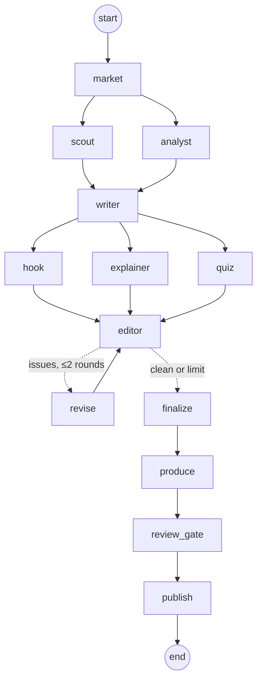
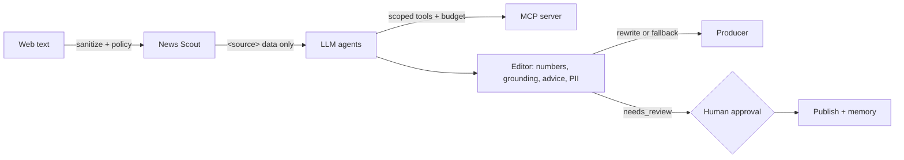

# Agentic AI principles in newsroom-ai

This project is a working reference for building agentic systems responsibly. Each principle below
names the concrete mechanism that implements it and where to find it in the code.

| # | Principle | How it is implemented | Where |
|---|---|---|---|
| 1 | **Single responsibility** | Eight agents, each with one job and a typed input/output contract | `agents/` |
| 2 | **Explicit orchestration** | A LangGraph `StateGraph`: parallel branches, a join, a bounded loop, an approval gate | `pipeline.py` |
| 3 | **Right-sized models** | Every agent declares a tier; a router maps `fast` / `smart` to different models per provider | `llm.py` · `LlmRouter` |
| 4 | **Structured outputs** | LangChain `with_structured_output` against Pydantic schemas, with automatic retries | `llm.py` · `models.py` |
| 5 | **Least privilege** | Each agent gets a scoped view of the MCP server with an allowlist and a call budget | `guardrails.py` · `TOOL_POLICY` |
| 6 | **Untrusted input** | Web text is sanitized against prompt injection and wrapped as `<source>` data in prompts | `guardrails.py` · `sanitize_untrusted` |
| 7 | **Content policy** | Explicit, graphic, self-harm and hate topics are excluded before any model sees them | `guardrails.py` · `policy_violation` |
| 8 | **Grounding** | Names and numbers on air must appear in the source or the fact sheet | `agents/editor.py` |
| 9 | **Verification in code** | Market numbers, quiz answers and attribution are checked deterministically, not by an LLM | `editor.py` · `QuizMaster.validate` |
| 10 | **Bounded autonomy** | At most two revision rounds; per-run LLM budget; hard 4-minute cap | `pipeline.py` · `LlmRouter` · `Producer` |
| 11 | **Graceful degradation** | Every LLM step has a deterministic fallback; a circuit breaker switches to them after repeated failures | `Agent.ask` · `_Metered` |
| 12 | **Human in the loop** | If guardrails had to rewrite on-air copy, the graph `interrupt`s for approval (`--review`) | `pipeline.py` · `review_gate` |
| 13 | **Memory with scope** | RAG archive limited to a 7-day window; segment memory for explainers and quizzes | `rag/store.py` · MCP tools |
| 14 | **Retrieval over recall** | Explainers come from a curated knowledge base, not the model's memory | `rag/explainers.md` |
| 15 | **Observability** | Every node, LLM call and tool call is a span; per-agent calls, latency and fallbacks are reported | `observability.py` · `trace.jsonl` · `run_report.json` |
| 16 | **Auditability** | Every guardrail decision is logged with layer, rule, severity and agent | `guardrails.json` |
| 17 | **Transparency** | AI-generated hosts and AI production are disclosed in every description; disclaimer added by code | `agents/producer.py` |
| 18 | **No harmful advice** | Buy/sell language and price targets are rejected; no predictions by design | `editor.py` · `ADVICE_RE` |
| 19 | **Reproducibility** | Deterministic renders (precomputed lip-sync, seeded wardrobe), pinned dependencies | `studio/` · `uv.lock` |
| 20 | **Testability** | An offline path (sample data, mock LLM, silent TTS) runs the full graph in tests | `tests/` |

## Agent roster

| Agent | Tier | Tools (allowlist) | Fallback |
|---|---|---|---|
| News Scout | smart | `get_ai_tech_news`, `search_news_archive`, `get_article_details` | rank by score with de-duplication |
| Market Analyst | smart | `search_style_guide` | fact-sheet template |
| Scriptwriter | smart | `search_style_guide` | source-only copy |
| Hook Writer | **fast** | `search_style_guide` | headline + biggest mover |
| Explainer | smart | `search_explainers`, `recent_segments`, `search_style_guide` | sentences from the vetted entry |
| Quiz Master | **fast** | `recent_segments` | data-derived market quiz |
| Editor | rules | — | — |
| Producer | rules | — | — |
| Orchestrator | — | `get_market_snapshot`, `record_coverage`, `record_segment` | — |

The fast tier handles short, tightly constrained outputs whose correctness is verified in code. The
smart tier handles editorial judgment and writing where quality matters. With a hosted provider,
the same split cuts cost without changing any agent.

## Orchestration graph

Generate the live version with `uv run newsroom graph`.

## Guardrail layers

## Run artefacts

Every episode directory contains:

- `run_report.json`: models per tier, LLM calls versus budget, per-agent usage, trace summary,
  editor first-pass rate, revisions, fallbacks and guardrail counts
- `guardrails.json`: each guardrail event, plus `needs_review`
- `trace.jsonl`: one span per node, LLM call and tool call, with timing
